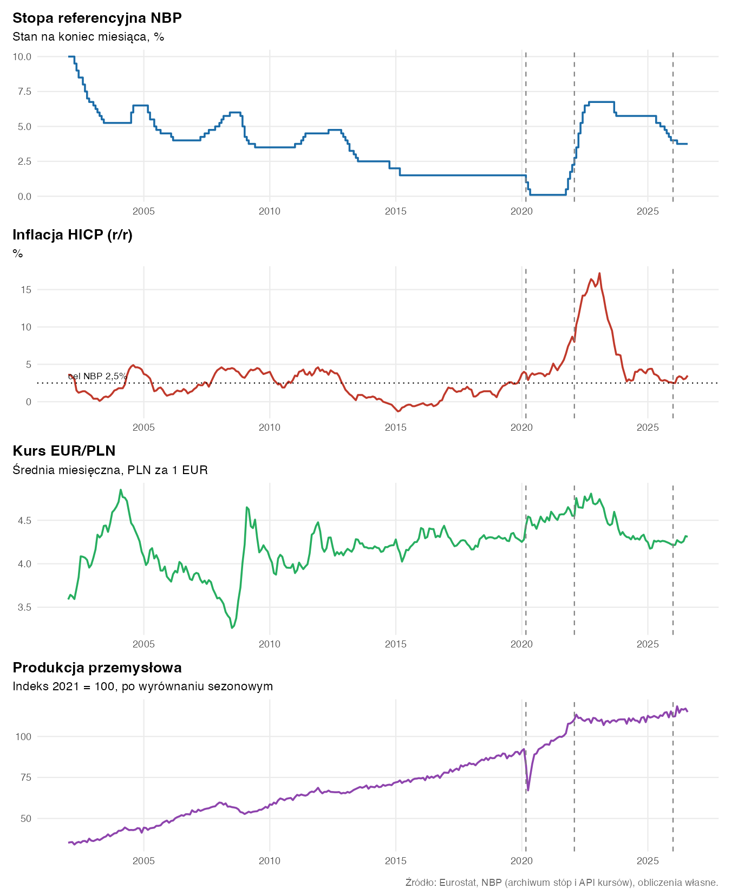
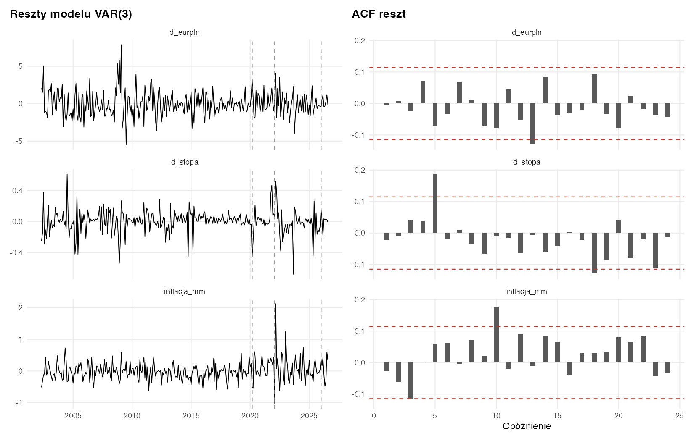
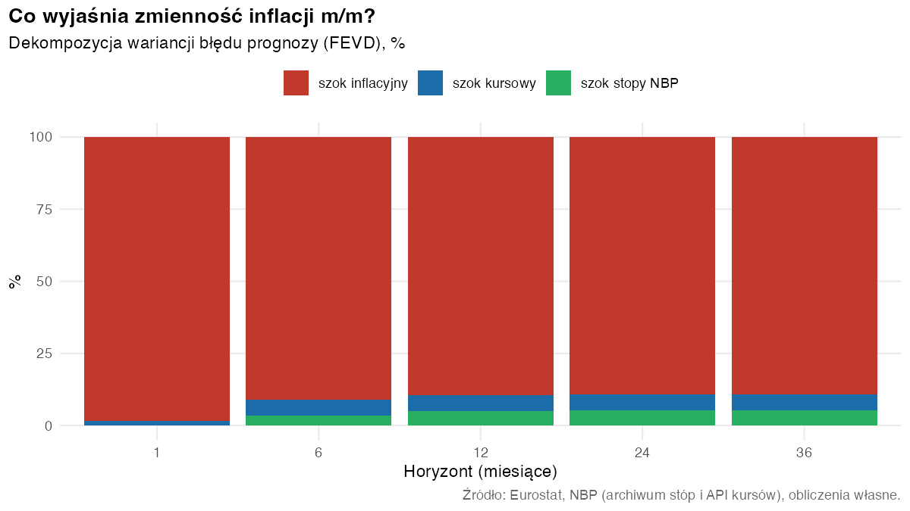
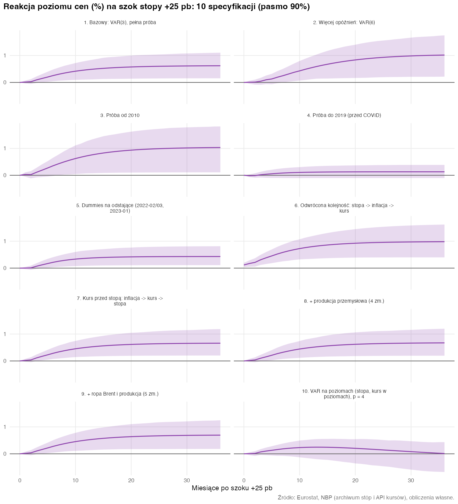

```{r}
#| label: root
#| echo: false
#| include: false
dir.create("figures", showWarnings = FALSE)             # raport ma własną kopię wykresów (Typst nie wychodzi poza katalog raportu)
invisible(file.copy(list.files("../output/figures", full.names = TRUE), "figures", overwrite = TRUE))
knitr::opts_knit$set(root.dir = normalizePath(".."))   # od następnego chunku ścieżki liczone od katalogu projektu
```

```{r}
#| label: setup
#| echo: false
#| include: false
suppressPackageStartupMessages({
  library(vars)        # przed tidyverse (maskowanie select)
  library(tidyverse)
})
source("R/var_pomocnicze.R"); source("R/motyw.R")

pval <- \(x) ifelse(is.na(x), "–", ifelse(x < 0.001, "<0,001", fmt(x, 3)))             # p-value po polsku
options(knitr.kable.NA = "–", OutDec = ",")
wczytaj <- \(f) read_csv(file.path("output/tables", f), show_col_types = FALSE)
fmt  <- \(x, d = 2) formatC(x, format = "f", digits = d, decimal.mark = ",")   # liczby po polsku
dm   <- \(d) format(d, "%m.%Y")

dane   <- readRDS("data/processed/dane_miesieczne.rds")
dvar   <- readRDS("data/processed/dane_var.rds")
model  <- readRDS("data/processed/model_var_bazowy.rds")
bt     <- readRDS("data/processed/irf_bootstrap_bazowy.rds")

stac   <- wczytaj("e3_testy_stacjonarnosci.csv")
mm     <- wczytaj("e3_testy_inflacja_mm.csv")
joh    <- wczytaj("e3_johansen_wrazliwosc.csv")
pozor  <- wczytaj("e3_regresja_pozorna.csv")
kand   <- wczytaj("e4_kandydaci_p.csv")
diag   <- wczytaj("e5_diagnostyka_zbiorcza.csv")
gr     <- wczytaj("e6_granger.csv")
irf    <- wczytaj("e6_irf_bazowy.csv")
fevd   <- wczytaj("e6_fevd.csv")
odp    <- wczytaj("e7_odpornosc.csv")
opis   <- wczytaj("statystyki_opisowe.csv")

# --- liczby cytowane w tekście (wszystkie z plików wynikowych) ---
w <- \(wielk, h, kol = "punkt") irf[[kol]][irf$wielkosc == wielk & irf$h == h]
rr <- irf |> filter(wielkosc == "infl_rr")
h_pierwsze_istotne <- min(rr$h[rr$lo90 > 0])
h_szczyt <- rr$h[which.max(rr$punkt)]
h_wygasa <- min(rr$h[rr$h > h_szczyt & rr$punkt < 0.1 * max(rr$punkt)])
g <- \(prz, sk, kol) gr[[kol]][gr$przyczyna == prz & gr$skutek == sk]
fe <- \(zm, szok, h, kol = "udzial") fevd[[kol]][fevd$zmienna == zm & fevd$szok == szok & fevd$h == h]
o  <- \(nr, kol) odp[[kol]][nr]
data_pobrania <- format(file.mtime("data/raw/stopy_procentowe_archiwum.xml"), "%d.%m.%Y")
```

# Streszczenie {.unnumbered}

**Pytanie.** Czy podwyżka stóp procentowych przez NBP obniża inflację w Polsce i po jakim czasie?

**Odpowiedź w trzech zdaniach.**

1. W danych miesięcznych z lat `r dm(min(dane$date))`–`r dm(max(dane$date))` **nie ma dowodu, że niespodziewana podwyżka stopy referencyjnej obniża inflację**. Po szoku o 25 pb poziom cen rośnie o ok. `r fmt(w("ceny_poziom", 12))`% po roku (przedział 90%: `r fmt(w("ceny_poziom", 12, "lo90"))` do `r fmt(w("ceny_poziom", 12, "hi90"))`%). Efekt pojawia się po ok. `r h_pierwsze_istotne` miesiącach, osiąga szczyt po `r h_szczyt` miesiącach i wygasa po ok. `r h_wygasa` miesiącach.
2. To **nie znaczy, że podwyżki podnoszą inflację**. Znaczy, że model nie potrafi oddzielić „nieoczekiwanej decyzji” od reakcji NBP na inflację, którą widzi, a model nie: stopa głównie *reaguje* na inflację (test Grangera inflacja → stopa: p = `r fmt(g("inflacja_mm", "d_stopa", "p_HC1"), 3)`), a nie odwrotnie (stopa → inflacja: p = `r fmt(g("d_stopa", "inflacja_mm", "p_HC1"), 2)`). W literaturze to zjawisko nazywa się *zagadką cenową* (*price puzzle*).
3. Wynik jest silnie zależny od okresu: w próbie do 2019 r. reakcja cen jest bliska zera (`r fmt(o(4, "ceny_h12"))`%, przedział obejmuje zero), a w próbach obejmujących lata 2020–2023 (COVID, szok inflacyjny) jest dodatnia i istotna. **Z tych danych i tej metody nie da się wiarygodnie ocenić siły oddziaływania stóp na inflację w Polsce**; zobacz [Ograniczenia](#ograniczenia).

::: {.callout-note}
## Jak czytać wyniki bez znajomości ekonometrii
*Szok monetarny* to decyzja o stopie, która była zaskoczeniem. Gdy bank podnosi stopy dokładnie wtedy, gdy rynek się tego spodziewał, a przyczyną jest rosnąca inflacja, nie widać „czystego” efektu stóp: widać raczej, że inflacja i stopy rosły razem. Metoda VAR próbuje wydzielić ten „czysty” składnik, ale robi to na podstawie założeń, które tutaj nie w pełni się sprawdzają.
:::

# Dane {#dane}

| Zmienna | Źródło | Zakres | Uwagi |
|---|---|---|---|
| Stopa referencyjna NBP | NBP, archiwum zmian stóp (XML), stan na koniec miesiąca | `r dm(min(dane$date))`–`r dm(max(dane$date))` | zgodna z danymi BIS w 344 z 344 wspólnych miesięcy |
| Inflacja HICP, r/r | Eurostat, `prc_hicp_minr`, `RCH_A` | od 01.1997 | pierwsze 12 miesięcy 1996 to braki (r/r wymaga historii) |
| Inflacja HICP, m/m | Eurostat, `prc_hicp_minr`, `RCH_M` | od 02.1996 | niewyrównana sezonowo |
| EUR/PLN | NBP API, tabela A, średnia z notowań w miesiącu | od 01.2002 | ponad 6 tys. notowań dziennych |
| Produkcja przemysłowa | Eurostat, `sts_inpr_m` (B–D, wyrównana, 2021 = 100) | od 01.2000 | zmienna kontrolna |
| Ropa Brent | FRED/EIA, średnia miesięczna, USD/baryłkę | od 1987 | zmienna kontrolna |

: Źródła danych {#tbl-dane}

Wspólny zakres czterech głównych zmiennych to **`r dm(min(dane$date))`–`r dm(max(dane$date))`** (`r nrow(dane)` miesięcy, bez luk). Dane pobrano `r data_pobrania`.

**Weryfikacja danych (co sprawdzono, zanim zaufano wynikom).**

- *Klasyfikacja Eurostatu.* Od danych za 01.2026 Eurostat używa ECOICOP v2 (`coicop18`), a stare tabele (`prc_hicp_manr`, `CP00`) są zarchiwizowane i urywają się w 12.2025. Użyto nowej tabeli. Na wspólnym okresie obie wersje różnią się o co najwyżej 0,2 pp.
- *Stopa NBP.* Atrybut `data_publikacji` w archiwum XML wskazuje 2015 r., choć treść sięga marca 2026 r. Aktualność oceniono po ostatniej dacie zmiany i po zgodności z BIS, nie po tym atrybucie. Stan na koniec miesiąca zgadza się z BIS w każdym miesiącu; średnia ważona dniami nie (78 miesięcy z różnicą > 0,05 pp), więc użyto stanu na koniec miesiąca.
- *Spójność inflacji.* Skumulowane 12 miesięcy inflacji m/m odtwarza r/r z dokładnością do zaokrągleń (maks. 0,3 pp).
- *Ostatni miesiąc.* Dane o inflacji kończą się w 08.2026; wrzesień 2026 nie został jeszcze opublikowany, a październik w kursie EUR/PLN jest niepełny, więc oba pominięto.

# Eksploracja

{#fig-szeregi fig-alt="Cztery wykresy liniowe: stopa referencyjna NBP, inflacja HICP r/r, kurs EUR/PLN i produkcja przemysłowa."}

Co widać:

- **Stopa NBP** spadała od 10% (2002) do 1,5% (2015–2020), spadła niemal do zera w 2020 r. (0,10% od 05.2020 do 09.2021), po czym została gwałtownie podniesiona do 6,75% w 2022–2023 r. i od 2025 r. jest obniżana (obecnie 3,75%). W latach 2020–2021 działało **ograniczenie dolne** stóp, co utrudnia estymację liniowego modelu.
- **Inflacja** przez większość próby mieściła się w pobliżu celu (2,5%), po czym w 2022 r. gwałtownie wzrosła, osiągając `r fmt(opis$max[opis$zmienna == "inflacja"], 1)`% w `r dm(opis$data_max[opis$zmienna == "inflacja"])`. Jest to największa obserwacja nietypowa w próbie i silnie wpływa na wyniki.
- **Kurs EUR/PLN** wahał się w przedziale `r fmt(opis$min[opis$zmienna == "eurpln"])`–`r fmt(opis$max[opis$zmienna == "eurpln"])`, z silnym osłabieniem złotego w 2008–2009 r. i w 2020–2022 r.
- **Produkcja** ma silny trend, a w 2020 r. załamanie i szybkie odbicie.

W poziomach stopa i inflacja są skorelowane dodatnio (r = `r fmt(cor(dane$stopa_kon, dane$inflacja))`), ale to korelacja na trendach i okresach, nie dowód zależności (zob. następny rozdział).

# Stacjonarność {#stacjonarnosc}

## Dlaczego to ważne

Regresja jednego trendującego szeregu na drugim często wygląda „świetnie”, nawet gdy szeregi nie mają ze sobą nic wspólnego. To **regresja pozorna** (Granger i Newbold, 1974). Sprawdziłem to na symulacji: dla `r fmt(pozor$n_symulacji, 0)` par *niezależnych* błądzeń losowych o długości `r fmt(pozor$n_obs, 0)` (tak jak w naszej próbie) test t uznaje związek za istotny w **`r fmt(100 * pozor$odsetek_istotnych, 0)`% przypadków** (powinno być 5%), przeciętne R² wynosi `r fmt(pozor$srednie_r2)`, a statystyka Durbina–Watsona `r fmt(pozor$mediana_dw)` (wartość bliska 0 oznacza silnie autokorelowane reszty). Na prawdziwych danych regresja inflacji na stopie w poziomach daje R² = `r fmt(pozor$r2_poziomy)` i DW = `r fmt(pozor$dw_poziomy)`. To symptom regresji pozornej. Ta sama regresja na różnicach ma DW = `r fmt(pozor$dw_roznice)`.

Dlatego przed budową VAR sprawdzamy, czy szeregi są stacjonarne (nie mają trwałego trendu i pierwiastka jednostkowego).

## Testy

Test ADF: hipoteza zerowa = niestacjonarność. Test KPSS: hipoteza zerowa = stacjonarność. Gdy oba wskazują to samo, wniosek jest pewny.

```{r}
#| label: tbl-stac
#| echo: false
#| tbl-cap: "Testy pierwiastka jednostkowego (ADF, KPSS). Przedrostek „d_” oznacza pierwszą różnicę; log × 100 dla kursu i produkcji."
stac |>
  transmute(Szereg = szereg, Specyfikacja = specyfikacja, `ADF tau` = fmt(adf_tau), `Wart. kryt. 5%` = fmt(adf_kryt5),
            `ADF: stacjonarny` = ifelse(adf_stacjonarny, "tak", "nie"), `KPSS p` = fmt(kpss_p, 3),
            `KPSS: stacjonarny` = ifelse(kpss_stacjonarny, "tak", "nie")) |>
  knitr::kable()
```

**Decyzja.**

- **Stopa, kurs (log) i produkcja (log)** są niestacjonarne w poziomach: KPSS odrzuca stacjonarność wszędzie, a ADF nie odrzuca pierwiastka jednostkowego w większości specyfikacji (wyjątki: kurs ze stałą, tau = −2,94 przy wartości krytycznej −2,87, i produkcja z trendem, ale w obu KPSS i tak wskazuje niestacjonarność). Pierwsze różnice są stacjonarne w obu testach, więc do modelu wchodzą jako pierwsze różnice. Wartości p testu KPSS są interpolowane i ograniczone do przedziału 0,01–0,10.
- **Inflacja r/r** też jest niestacjonarna w poziomach, ale jej różnica ma problem techniczny: Δ(r/r) = π(t) − π(t−12) ma mechanicznie ujemną autokorelację na opóźnieniu 12 (efekt bazy; w danych −0,36), co psuje diagnostykę. Dlatego w modelu użyto **inflacji m/m**, która takiej cechy nie ma, ale ma sezonowość (stąd dummies miesięczne).
- **Inflacja m/m** po usunięciu sezonowości: ADF odrzuca pierwiastek jednostkowy (tau = `r fmt(mm$adf_tau[2])`), ale KPSS odrzuca stacjonarność (p = `r fmt(mm$kpss_p[2], 3)`). W próbie do 2019 r. oba testy wskazują stacjonarność. Rozbieżność wynika z przesunięcia średniej inflacji w latach 2021–2023. Traktuję ją jako stacjonarną, **z zastrzeżeniem**, że to założenie jest najsłabszym punktem specyfikacji.

## Kointegracja

Jeśli niestacjonarne szeregi mają wspólny trend (są skointegrowane), różnicowanie gubi relację długookresową. Test Johansena daje jednak niespójny obraz: liczba relacji kointegrujących zależy od liczby opóźnień i od próby (@tbl-joh). Dla trzech zmiennych wynik „r = 3” oznaczałby, że wszystkie są stacjonarne, co przeczy ADF, więc test przesadnie odrzuca. W próbie do 2019 r. przeważa brak kointegracji. Przyjęto VAR na różnicach jako model główny, a **VAR na poziomach** sprawdzono w rozdziale o odporności (specyfikacja 10; w poziomach estymacja jest zgodna nawet przy kointegracji).

```{r}
#| label: tbl-joh
#| echo: false
#| tbl-cap: "Liczba relacji kointegrujących (test śladu Johansena, 5%) dla różnych opóźnień K i prób."
joh |> pivot_wider(names_from = K, values_from = r, names_prefix = "K = ") |>
  rename(Próba = proba) |>
  knitr::kable()
```

# Specyfikacja modelu VAR {#specyfikacja}

## Model

VAR to układ równań, w którym każda zmienna zależy od własnych opóźnień i opóźnień pozostałych zmiennych. Główny model ma trzy zmienne: **inflację m/m**, **zmianę stopy NBP** (pp) i **zmianę logarytmu kursu EUR/PLN** (×100, w przybliżeniu % deprecjacji złotego), a także stałą i dummies miesięczne.

## Liczba opóźnień

```{r}
#| label: tbl-kand
#| echo: false
#| tbl-cap: "Kandydaci na liczbę opóźnień. Autokorelacja reszt: chcemy p > 0,05."
kand |> transmute(`Opóźnienia p` = p, `Portmanteau (24), p` = pval(portmanteau_p),
                  `Breusch–Godfrey (6), p` = pval(bg6_p), `Największy pierwiastek` = fmt(max_pierwiastek, 2),
                  `Parametrów na równanie` = liczba_parametrow_na_rownanie) |>
  knitr::kable()
```

Kryteria informacyjne dają różne wskazania: AIC i FPE wybierają **p = 3**, HQ i SC wybierają p = 1. Przy p = 1 reszty są jednak wyraźnie autokorelowane (Portmanteau p ≈ 0,01), więc to p odrzucam. Wybrano **p = 3**: to opóźnienie z najniższym AIC i z poprawnymi resztami wg testu Portmanteau. Test Breusch–Godfreya (z 6 i 12 opóźnieniami) nadal odrzuca brak autokorelacji; przechodzi dopiero p = 6, które sprawdzono w rozdziale o odporności (wnioski się nie zmieniają).

## Kolejność zmiennych (identyfikacja Choleskiego)

Reszty modelu są ze sobą skorelowane, więc aby mówić o „szoku monetarnym”, trzeba przyjąć założenie o kolejności reakcji w ramach miesiąca (rozkład Choleskiego). Przyjęto:

**inflacja → stopa NBP → kurs EUR/PLN.**

- *Inflacja pierwsza*: ceny konsumenckie są sztywne i nie reagują na decyzję RPP w tym samym miesiącu.
- *Stopa druga*: RPP reaguje na bieżące dane o inflacji. To założenie jest ostrożne: korelacja reszt inflacja–stopa wynosi 0,23, więc odwrócenie kolejności przypisałoby tę wspólną część „szokowi stopy” i nasiliło zagadkę cenową (specyfikacja 6).
- *Kurs ostatni*: kurs walutowy to cena aktywa reagująca natychmiast na decyzję RPP, ale w rzeczywistości także na całą informację rynkową.

To standardowy schemat (Christiano, Eichenbaum i Evans, 1999), ale **jest to założenie, nie wynik**. Zbadano także kolejność odwrotną (stopa pierwsza) i kurs przed stopą.

## Estymacja

```{r}
#| label: estymacja
#| eval: false
dane_var <- readRDS("data/processed/dane_var.rds")
model <- estymuj_var(dane_var, c("inflacja_mm", "d_stopa", "d_eurpln"), p = 3)  # vars::VAR, stała + dummies miesięczne
summary(model)
```

Próba efektywna: `r model$obs` obserwacji (`r dm(dvar$date[model$p + 1])`–`r dm(max(dvar$date))`).

# Diagnostyka modelu {#diagnostyka}

```{r}
#| label: tbl-diag
#| echo: false
#| tbl-cap: "Diagnostyka modelu bazowego VAR(3)."
diag |> transmute(Test = test, `H0` = H0, `p` = pval(p_value),
                  Wynik = wynik, `Co robić, gdy nie przechodzi` = co_robic_gdy_nie_przechodzi) |>
  knitr::kable()
```

{#fig-reszty fig-alt="Wykresy reszt trzech równań w czasie oraz funkcje autokorelacji reszt."}

**Co przechodzi.** Model jest *stabilny* (największy pierwiastek `r fmt(max(Mod(roots(model, modulus = FALSE))), 2)` < 1), więc funkcje reakcji na impuls wygasają, a reszty nie są autokorelowane wg testu Portmanteau.

**Co nie przechodzi, i co to oznacza.**

- *Normalność i heteroskedastyczność* (JB, ARCH): odrzucone silnie. Reszty mają grube ogony (kurtoza inflacji m/m ≈ 11) i zmienną wariancję: odchylenie reszt inflacji jest w latach 2020–2022 ok. dwa razy większe niż wcześniej. Główne źródło to marzec 2022 r. (inflacja m/m +2,1 pp, ok. 7 odchyleń standardowych). *Konsekwencja:* przedziały ufności z założeniem normalności byłyby zawodne, więc użyto **bootstrapu reszt**, a wyniki sprawdzono z dummies na odstające obserwacje i na krótszych próbach. Istotność oceniano testami odpornymi (HC1).
- *Breusch–Godfrey*: odrzuca brak autokorelacji, choć Portmanteau nie. Autokorelacja jest słaba (kilka opóźnień nieznacznie przekracza pasmo). Sprawdzono p = 6.
- *Stabilność parametrów* (CUSUM): przekroczona dla równania inflacji, co odpowiada **zmianie reżimu** w 2021–2023. To jedno z głównych ograniczeń analizy.

# Wyniki {#wyniki}

## Przyczynowość w sensie Grangera

Test Grangera pyta: czy przeszłe wartości zmiennej X pomagają przewidywać Y ponad to, co wynika z przeszłości samego Y? To przewidywalność, a nie przyczynowość w sensie potocznym.

```{r}
#| label: tbl-granger
#| echo: false
#| tbl-cap: "Testy Grangera, VAR(3). Odporny test uwzględnia heteroskedastyczność."
gr |> transmute(Przyczyna = przyczyna, Skutek = skutek, `F` = fmt(F_klasyczny), `p (klasyczny)` = pval(p_klasyczny),
                `p (odporny, HC1)` = pval(p_HC1)) |>
  knitr::kable()
```

- **Inflacja → stopa:** istotna (p = `r fmt(g("inflacja_mm", "d_stopa", "p_HC1"), 3)`): NBP reaguje na inflację, co jest zgodne z regułą polityki pieniężnej.
- **Stopa → inflacja:** nieistotna w teście odpornym (p = `r fmt(g("d_stopa", "inflacja_mm", "p_HC1"), 3)`); istotna dopiero w klasycznym teście (p = `r fmt(g("d_stopa", "inflacja_mm", "p_klasyczny"), 3)`), który nie jest odporny na zmienną wariancję reszt.
- **Kurs → inflacja:** istotne (p = `r fmt(g("d_eurpln", "inflacja_mm", "p_HC1"), 3)`), co jest zgodne z przenoszeniem zmian kursu na ceny.

## Funkcje reakcji na impuls (IRF)

IRF pokazuje, jak zmienne reagują w kolejnych miesiącach na jednorazowy, nieoczekiwany wzrost stopy NBP o 25 pb (typowy krok RPP). Przedziały pochodzą z bootstrapu reszt (1000 replikacji).

```{r}
#| label: fig-irf
#| fig-cap: "Reakcja na nieoczekiwany wzrost stopy NBP o 25 pb. Linia: estymacja punktowa; pasma: 68% i 90%."
#| fig-alt: "Cztery panele: poziom stopy NBP, inflacja r/r, poziom cen HICP i kurs EUR/PLN po szoku stopy, z pasmami niepewności."
#| fig-width: 9
#| fig-height: 6.5
pasma <- \(wielkosc, tytul, kolor) {
  przedzialy(bt, wielkosc) |>
    ggplot(aes(h)) +
    geom_ribbon(aes(ymin = lo90, ymax = hi90), fill = kolor, alpha = 0.15) +
    geom_ribbon(aes(ymin = lo68, ymax = hi68), fill = kolor, alpha = 0.30) +
    geom_hline(yintercept = 0, color = "grey40") +
    geom_line(aes(y = punkt), color = kolor, linewidth = 0.9) +
    labs(title = tytul, x = "Miesiące po szoku", y = NULL) + motyw_projektu()
}
library(patchwork)
(pasma("stopa_poziom", "Stopa NBP (pp)", "#1b6ca8") + pasma("infl_rr", "Inflacja r/r (pp)", "#c0392b")) /
(pasma("ceny_poziom", "Poziom cen HICP (%)", "#8e44ad") + pasma("kurs_poziom", "EUR/PLN (%; + = słabszy złoty)", "#27ae60"))
```

| Po ilu miesiącach | Poziom cen (%) | Inflacja r/r (pp) | EUR/PLN (%) |
|---|---|---|---|
| 6 | `r fmt(w("ceny_poziom", 6))` [`r fmt(w("ceny_poziom", 6, "lo90"))`; `r fmt(w("ceny_poziom", 6, "hi90"))`] | `r fmt(w("infl_rr", 6))` | `r fmt(w("kurs_poziom", 6))` [`r fmt(w("kurs_poziom", 6, "lo90"))`; `r fmt(w("kurs_poziom", 6, "hi90"))`] |
| 12 | `r fmt(w("ceny_poziom", 12))` [`r fmt(w("ceny_poziom", 12, "lo90"))`; `r fmt(w("ceny_poziom", 12, "hi90"))`] | `r fmt(w("infl_rr", 12))` [`r fmt(w("infl_rr", 12, "lo90"))`; `r fmt(w("infl_rr", 12, "hi90"))`] | `r fmt(w("kurs_poziom", 12))` [`r fmt(w("kurs_poziom", 12, "lo90"))`; `r fmt(w("kurs_poziom", 12, "hi90"))`] |
| 24 | `r fmt(w("ceny_poziom", 24))` [`r fmt(w("ceny_poziom", 24, "lo90"))`; `r fmt(w("ceny_poziom", 24, "hi90"))`] | `r fmt(w("infl_rr", 24))` | `r fmt(w("kurs_poziom", 24))` [`r fmt(w("kurs_poziom", 24, "lo90"))`; `r fmt(w("kurs_poziom", 24, "hi90"))`] |

: Reakcja na szok +25 pb: estymacja punktowa i [przedział 90%]. {#tbl-irf}

Interpretacja:

- **Stopa:** po szoku +25 pb poziom stopy dalej rośnie (do ok. `r fmt(w("stopa_poziom", 24))` pp po dwóch latach), bo zmiany stóp są autokorelowane (cykle podwyżek).
- **Ceny:** poziom cen **rośnie**, nie spada. Dodatnia reakcja jest statystycznie istotna od ok. `r h_pierwsze_istotne` miesiąca. To zagadka cenowa.
- **Inflacja r/r:** zmiana poziomu cen w ciągu ostatnich 12 miesięcy; szczyt `r fmt(max(rr$punkt))` pp po `r h_szczyt` miesiącach, potem wygasanie.
- **Kurs:** złoty się *umacnia* (EUR/PLN spada o ok. `r fmt(-w("kurs_poziom", 12))`% po roku), co jest zgodne z teorią, ale przedział 90% obejmuje zero, więc efekt jest niepewny.

## Dekompozycja wariancji (FEVD)

Jaką część nieprzewidywalnej zmienności inflacji wyjaśnia każdy szok?

{#fig-fevd fig-alt="Wykres słupkowy udziału szoków inflacyjnych, stopy NBP i kursowych w wariancji inflacji na różnych horyzontach."}

Po roku szok stopy NBP wyjaśnia ok. **`r fmt(fe("inflacja_mm", "d_stopa", 12), 1)`%** zmienności inflacji (przedział 90%: `r fmt(fe("inflacja_mm", "d_stopa", 12, "lo90"), 1)`–`r fmt(fe("inflacja_mm", "d_stopa", 12, "hi90"), 1)`%), szok kursowy ok. `r fmt(fe("inflacja_mm", "d_eurpln", 12), 1)`%, a **ok. `r fmt(fe("inflacja_mm", "inflacja_mm", 12), 0)`% to własne, nieobjaśnione szoki inflacji** (m.in. ceny energii i żywności, które model ujmuje tylko pośrednio). Odwrotnie, ok. `r fmt(fe("d_stopa", "inflacja_mm", 12), 0)`% zmienności stopy wyjaśnia inflacja (reguła reakcji NBP).

# Odporność wyników {#odpornosc}

Ta sama analiza (IRF, Granger, FEVD) została powtórzona w 10 wariantach: inne opóźnienia, inne okresy, odwrócona kolejność, dummies na obserwacje odstające, dodatkowe zmienne (produkcja, ropa) i VAR na poziomach.

```{r}
#| label: tbl-odp
#| echo: false
#| tbl-cap: "Odporność: reakcja na szok stopy +25 pb (estymacja punktowa i przedział 90%) oraz testy Grangera (odporne)."
odp |> transmute(`Specyfikacja` = specyfikacja, T = T,
                 `Ceny po 12 mies. (%)` = sprintf("%s [%s; %s]", fmt(ceny_h12), fmt(ceny_h12_lo90), fmt(ceny_h12_hi90)),
                 `EUR/PLN po 12 mies. (%)` = sprintf("%s [%s; %s]", fmt(kurs_h12), fmt(kurs_h12_lo90), fmt(kurs_h12_hi90)),
                 `Granger stopa→infl., p` = pval(granger_stopa_infl_pHC1),
                 `Granger infl.→stopa, p` = pval(granger_infl_stopa_pHC1)) |>
  knitr::kable()
```

{#fig-odp fig-alt="Dziesięć paneli z funkcjami reakcji poziomu cen na szok stopy w różnych specyfikacjach modelu."}

**Co jest stabilne:**

- Znak „zagadki cenowej” (dodatnia reakcja poziomu cen po 12 miesiącach) jest taki sam w `r sum(odp$ceny_h12 > 0)` z `r nrow(odp)` specyfikacji. Przedział 90% nie obejmuje zera w `r sum(odp$ceny_h12_lo90 > 0 | odp$ceny_h12_hi90 < 0)` z `r nrow(odp)`.
- *Inflacja → stopa* jest istotna (p < 0,05) w `r sum(odp$granger_infl_stopa_pHC1 < 0.05)` z `r nrow(odp)` specyfikacji; *stopa → inflacja* tylko w `r sum(odp$granger_stopa_infl_pHC1 < 0.05)` z `r nrow(odp)` (w specyfikacji z dummies na odstające, gdzie – z powodu osobliwej macierzy odpornej – użyto testu klasycznego), więc ta zależność nie jest odporna.
- Dodanie produkcji i ropy (spec. 8–9) nie usuwa zagadki; zmiana kolejności (spec. 6–7) zmienia jej wielkość, nie znak.

**Co jest niestabilne:**

- *Wielkość efektu.* Reakcja cen po roku wynosi od `r fmt(min(odp$ceny_h12))` do `r fmt(max(odp$ceny_h12))`%. W próbie do 2019 r. (spec. 4) oraz w VAR na poziomach (spec. 10) przedział obejmuje zero. W próbie od 2010 r. (spec. 3) efekt jest największy (`r fmt(o(3, "ceny_h12"))`%).
- *Kurs.* Umocnienie złotego po podwyżce (punktowo ujemna reakcja w `r sum(odp$kurs_h12 < 0)` z `r nrow(odp)` specyfikacji) jest istotne praktycznie tylko w próbie do 2019 r. (`r fmt(o(4, "kurs_h12"))`% po roku), gdzie przedział 90% nie obejmuje zera. W próbie od 2010 r. znak jest odwrotny.

**Wniosek:** wnioski jakościowe (NBP reaguje na inflację, w 9 z 10 specyfikacji; brak dowodu na obniżanie inflacji po szoku stopy) są stabilne. Ilościowe oszacowania nie są.

# Ograniczenia {#ograniczenia}

1. **Identyfikacja.** „Szok” w modelu to część zmiany stopy nieprzewidywana na podstawie trzech zmiennych i trzech opóźnień. NBP reaguje na prognozy inflacji, oczekiwania, ceny surowców i kondycję gospodarki, których tu nie ma w pełni. Skutek: zagadka cenowa i wątpliwość, czy „szok” to naprawdę decyzja niespodziewana. Poprawa wymagałaby danych o oczekiwaniach (projekcje NBP, ankiety), danych o decyzjach w wysokiej częstotliwości lub restrykcji znaków.
2. **Zmiana reżimu.** Parametry nie są stabilne (CUSUM), a lata 2020–2023 (COVID, szok energetyczny, wojna) dominują wyniki. Przyjęcie jednego modelu liniowego na 24 lata to uproszczenie.
3. **Ograniczenie dolne stóp.** W latach 2020–2021 stopa wynosiła 0,10%, więc nie mogła spaść dalej; relacja stopa–inflacja jest wtedy inna.
4. **Inflacja ogółem (HICP)** zawiera ceny energii i żywności, na które polityka pieniężna wpływa słabo. Inflacja bazowa mogłaby dawać wyraźniejszy obraz (nie była używana).
5. **Kointegracja.** Wyniki testu Johansena są niespójne; model różnicowy może pomijać relacje długookresowe (sprawdzono VAR na poziomach).
6. **Założenie o stacjonarności inflacji m/m** jest wątpliwe w całej próbie (KPSS), choć do 2019 r. spełnione.
7. **Rozkład reszt.** Grube ogony i heteroskedastyczność; przedziały z bootstrapu mogą być zbyt wąskie przy zmiennej wariancji.
8. **Próba i częstotliwość.** `r nrow(dvar)` obserwacji miesięcznych; ok. 20–30 parametrów na równanie. Stopa NBP zmienia się rzadko (ok. 74 zmiany w próbie), więc wiele miesięcy ma zerową zmianę.
9. **Dane z końca próby.** Dane o inflacji do 08.2026; ostatni wpis w archiwum stóp to 03.2026 (zgodność ze stanem do 09.2026 potwierdzona danymi BIS).
10. **Wynik nie jest zaleceniem polityki** ani oceną działań NBP.

# Podsumowanie

- **Co zrobiono:** pełny pipeline od pobrania i weryfikacji danych, przez testy stacjonarności, specyfikację i diagnostykę VAR, po IRF, FEVD i 10 testów odporności.
- **Co z tego wynika:** w danych polskich z lat 2002–2026 prosty VAR nie pozwala wykazać, że podwyżki stóp NBP obniżają inflację. Pozwala za to udokumentować, że NBP reaguje na inflację, i pokazać, jak ważne są identyfikacja i zmiana reżimu.
- **Co dalej:** modele ze zmiennymi parametrami lub podział na reżimy; identyfikacja przez restrykcje znaków albo dane wysokiej częstotliwości; inflacja bazowa; oczekiwania inflacyjne.

# Odtwarzalność {.unnumbered}

Cały kod: skrypty `etap1_dane.R`–`etap7_odpornosc.R`, funkcje w `R/`, uruchomienie całości przez `Rscript run_all.R`. Środowisko:

```{r}
#| label: sesja
#| echo: false
cat(R.version.string, "\n")
for (p in c("vars", "tidyverse", "eurostat", "urca", "tseries", "httr2", "xml2", "patchwork", "car", "sandwich"))
  cat(sprintf("%-10s %s\n", p, as.character(packageVersion(p))))
```

# Literatura {.unnumbered}

- Christiano, L., Eichenbaum, M., Evans, C. (1999). Monetary policy shocks: What have we learned and to what end? *Handbook of Macroeconomics*, t. 1A.
- Granger, C., Newbold, P. (1974). Spurious regressions in econometrics. *Journal of Econometrics* 2(2), 111–120.
- Lütkepohl, H. (2005). *New Introduction to Multiple Time Series Analysis*. Springer.
- Pfaff, B. (2008). VAR, SVAR and SVEC models: Implementation within R package vars. *Journal of Statistical Software* 27(4).
- Sims, C. (1980). Macroeconomics and reality. *Econometrica* 48(1), 1–48.
- Sims, C. (1992). Interpreting the macroeconomic time series facts: The effects of monetary policy. *European Economic Review* 36(5), 975–1000.
